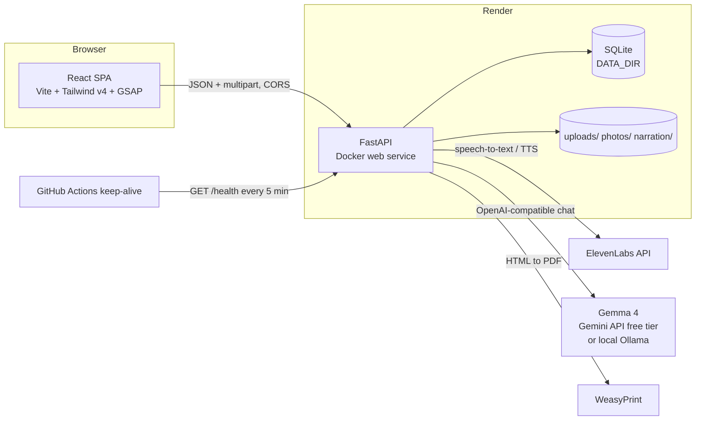

# Architecture

## System



The frontend is a static site with no secrets. Every key lives only in the backend's environment.

## Repository layout

```
backend/
  app/
    main.py        routes, CORS, request logging, startup recovery
    config.py      Settings from env (+ .env for local dev)
    models.py      SQLModel Recipe table, lightweight column migration
    schemas.py     Pydantic request/response models, input cleaning
    pipeline.py    background jobs: transcribe -> structure
    llm.py         Gemma client: throttle, 429/5xx retry, thought stripping, JSON repair
    prompts.py     system prompt + few-shot examples (edit freely)
    eleven.py      ElevenLabs STT and TTS
    photos.py      Pillow: validate, orient, strip EXIF, resize, JPEG
    pdf.py         Jinja2 + WeasyPrint
    templates/book.html   cookbook print stylesheet
  fonts/           Lora (OFL) for the PDF
  tests/           pytest, all external calls mocked
  Dockerfile
frontend/
  src/
    router.tsx     routes, lazy pages, error element
    api.ts         typed API client
    strings.ts     all UI strings (i18n-ready)
    content/       long-form copy: landing.ts, guide.ts
    classics.ts    six classic recipes + transcripts
    components/    Layout, HeroStories, Img, CookMode, ConfirmDialog, Toast, ...
    pages/         Landing, Library, RecipePage, AddMemo, BookPage, Guide, Credits, NotFound, RouteError
  public/          favicon, icons, og-image, images/ (WebP + CREDITS.md)
samples/           fictional transcripts (.txt)
scripts/demo.py    transcript -> recipe -> demo-book.pdf
docs/              this folder
render.yaml        Blueprint: API (Docker) + static site
.github/workflows/ ci.yml, keep-alive.yml
```

## Data model

`Recipe` (SQLite via SQLModel). JSON columns for lists.

| Field | Type | Notes |
| --- | --- | --- |
| id | int | PK |
| created_at, updated_at | datetime | UTC |
| status | str | `uploaded`, `transcribing`, `structuring`, `ready`, `failed` |
| error | str? | human-readable reason when failed |
| title, story, servings, prep_time, cook_time | str | |
| ingredients | JSON | `[{name, quantity?, note?}]` |
| steps, tips | JSON | `[str]` |
| quote | str | verbatim substring of transcript |
| transcript | str | raw |
| speaker_name | str? | |
| audio_path, narration_path, photo_path | str? | files under `DATA_DIR` |
| favorite | bool | default false; kept through edits and backups |

New columns are added at startup with `ALTER TABLE` (`models._ADDED_COLUMNS`) because SQLite `create_all` never alters tables.

## API

| Method | Path | Purpose |
| --- | --- | --- |
| GET/HEAD | `/health` | Keep-alive. Touches nothing. |
| GET | `/api/status` | Capabilities: transcription, narration, model reachable (cached 60s), limits |
| POST | `/api/memos` | Multipart audio upload, starts background job |
| POST | `/api/transcript` | Pasted transcript, starts structuring |
| POST | `/api/recipes` | Create a finished recipe (by hand, classics) |
| GET | `/api/recipes?q=&favorite=` | List, newest first, optional search and favourites filter |
| GET/PUT/DELETE | `/api/recipes/{id}` | Read, edit (409 while processing), delete (files too) |
| PATCH | `/api/recipes/{id}/favorite` | `{favorite: bool}`; changes nothing else |
| POST | `/api/recipes/{id}/restructure` | Re-run model; sets status before responding |
| POST/DELETE | `/api/recipes/{id}/photo` | Upload (processed to JPEG) / remove |
| POST | `/api/recipes/{id}/narrate` | ElevenLabs TTS, cached mp3 |
| GET | `/api/recipes/{id}/pdf` | Single recipe PDF |
| GET | `/api/book.pdf?ids=&title=&dedication=` | Book PDF, ready recipes only, de-duplicated |
| GET | `/api/export` / POST `/api/import` | JSON backup / restore (max 500) |
| static | `/media/photos/*`, `/media/narration/*` | Files |

## Accounts and limits

- `app/auth.py`. Modes: `google` (when `GOOGLE_CLIENT_ID` is set), `dev` (one local account; default outside production), `closed` (production without a client id: every recipe endpoint returns 503, fail closed).
- Sign-in: the browser loads Google Identity Services (only on `/signin`), gets an ID token, and posts it to `POST /api/auth/google`. The server verifies signature, audience and issuer with `google-auth`, requires a verified email, applies `ALLOWED_EMAILS`, upserts a `User`, and returns its own session token (`itsdangerous`, signed with `SESSION_SECRET`, expires after `SESSION_DAYS`).
- The browser sends `Authorization: Bearer <token>`. `current_user` is a FastAPI dependency on every recipe endpoint; `_get()` returns 404 for other people's recipes. Media files use random 24-character names.
- Daily allowance: `USER_DAILY_LIMIT` (default 5) AI actions per account per UTC day, checked before a request (`check_allowance`, 429) and counted only when Gemma or ElevenLabs is really called (`spend`, in the pipeline). Reused transcripts, hand-written recipes, edits, photos and books are free.
- `GET /api/auth/config` (public), `GET/DELETE /api/auth/me`.
- The first account adopts recipes created before accounts existed.
- Anti-spam: throwaway email domains refused at sign-in; `NetworkUsage` counts AI requests per network per day and `User.signup_ip_hash` limits new accounts per network. The client IP comes only from `CLIENT_IP_HEADER`, and is stored as a salted hash.

## CI and quality gates

`.github/workflows/ci.yml` on every push and pull request: ruff lint and format, pytest on Python 3.13 and 3.14 with deprecations as errors and branch coverage at least 90%, pip-audit, Oxlint (zero warnings), TypeScript, production build and bundle secret scan, npm audit, Gitleaks over history, Docker Compose build with health checks and non-root checks, then the Playwright suites (`e2e/app.mjs`, `e2e/responsive.mjs`). A final `All checks passed` job gates merging. `codeql.yml` (Python, TypeScript, Actions) and `pr.yml` (conventional PR title, dependency review) also run on pull requests; Dependabot keeps pip, npm, Docker and Actions current.

## Processing pipeline

1. Upload saved to `DATA_DIR/uploads/<uuid>.<ext>`; row created; `BackgroundTasks` runs `process_audio`.
2. `eleven.transcribe` -> transcript stored.
3. `llm.structure_recipe`:
   - an identical transcript that is already a ready recipe is reused with no model call (not for Rewrite);
   - system prompt + few-shot (`prompts.py`), temperature 0.2, JSON mode requested, `thinking_level` passed to Google;
   - `_daily_cap()` stops at `LLM_MAX_PER_DAY`; `_throttle()` keeps under `LLM_MAX_RPM`; a lock sends one call at a time;
   - `spend_guard` (in `main.py`) limits quota-spending requests per visitor (`SUBMIT_LIMIT` per 10 minutes);
   - 429 waits for the provider's `retryDelay`; 5xx backs off 4s, 16s; then a clear error;
   - 400/422 retries once without `response_format` (providers that reject JSON mode);
   - `<thought>` blocks (Gemma 4 reasoning) are stripped before parsing;
   - Pydantic validation; up to 2 repair retries with the error fed back;
   - `verify_quote` replaces a non-verbatim quote with the closest real sentence.
4. Status `ready`, or `failed` with a reason. On boot, anything left in progress is marked failed ("server restarted").

## LLM provider (open-weight requirement)

The app speaks the OpenAI chat-completions protocol, so the host is configuration:

| Setup | `LLM_BASE_URL` | `LLM_MODEL` | Cost |
| --- | --- | --- | --- |
| **Gemini API free tier (default)** | `https://generativelanguage.googleapis.com/v1beta/openai` | `gemma-4-26b-a4b-it` | free, rate limited |
| Local Ollama | `http://localhost:11434/v1` | `gemma3:4b` | free, needs ~8 GB RAM |
| OpenRouter or similar | provider URL | a Gemma model id | varies |

Gemini (closed) models must not be used: the challenge requires open-weight AI. Measured on `gemma-4-26b-a4b-it`: ~80-190s with default reasoning, ~15-35s with `LLM_THINKING_LEVEL=minimal` (the default).

## Frontend

- React 19, React Router 7 data router (`createBrowserRouter`) for `useBlocker` (unsaved changes) and `errorElement`.
- Landing is in the main bundle; all other pages are `React.lazy` with skeleton fallbacks.
- `Img` component: skeleton until decoded, lazy by default, gingham fallback on error.
- GSAP (+ ScrollTrigger, `@gsap/react` `useGSAP`) only on the landing page and hero carousel; everything wrapped in `gsap.matchMedia("(prefers-reduced-motion: no-preference)")`.
- Polling (`useRecipePoll`) with exponential back-off on errors; stops on `ready`, `failed`, or 404.
- `WarmUp` pings `/health` on load and every 5 minutes; shows the wake-up banner after 3s; offline banner from `navigator.onLine`.
- `CapabilitiesProvider` fetches `/api/status` once (retries while the server wakes) and the UI disables what the server cannot do.

## Docker

`docker-compose.yml` runs two images:

| Service | Image | Notes |
| --- | --- | --- |
| `web` | `frontend/Dockerfile`: Node build, then `nginxinc/nginx-unprivileged` (uid 101, port 8080) | `frontend/nginx.conf` serves the SPA (fallback to `index.html`), proxies `/api`, `/media`, `/health` to `api:8000`, sets CSP and security headers, caches `/assets` and `/images`. Built with `VITE_API_URL=""` so the app calls its own origin. |
| `api` | `backend/Dockerfile`: Python slim + Pango/Cairo (uid 10001) | Not published; health-checked; `--proxy-headers` so per-visitor limits see real client IPs from nginx. Data in the `salt-data` volume. |

Secrets reach the API container from `.env` via `env_file` at runtime only.

## PDF engine outside Docker

`pdf._prepare_native_libraries()` (Windows only) finds Pango in `backend/.gtk/Library/bin` (from `scripts/setup-pdf-windows.ps1`), MSYS2, GTK3-Runtime or the active conda env, and sets `WEASYPRINT_DLL_DIRECTORIES` and `PATH` before WeasyPrint loads. macOS uses Homebrew's Pango, Linux the system packages. If none are found the API returns a 503 naming the fix for that OS.

## Deployment

See the README's deploy section. Summary: Render Blueprint (`render.yaml`) creates `salt-and-story-api` (Docker, free) and `salt-and-story-web` (static). Deploy API, then web with `VITE_API_URL`, then set `CORS_ORIGINS` on the API. Secrets are `sync: false` env vars set in the Render dashboard. Free disk is ephemeral: use backups or a paid disk.

## Security model

- Secrets only in backend env (`.env` locally, gitignored and dockerignored; Render env vars in prod).
- CORS allow-list from `CORS_ORIGINS`, no wildcard.
- Uploads: extension allow-list, size caps streamed, empty files rejected, images re-encoded by Pillow (kills polyglots, strips EXIF/GPS), random filenames, served as static files only from `DATA_DIR`.
- Inputs: Pydantic validation, title required, transcript length cap, import count cap.
- Errors: provider errors mapped to fixed messages; unexpected exceptions get a generic message; stack traces only in server logs; keys never logged.
- Static site: security headers via `render.yaml` (CSP, nosniff, frame-ancestors, referrer policy).
- Container runs as a non-root user.
